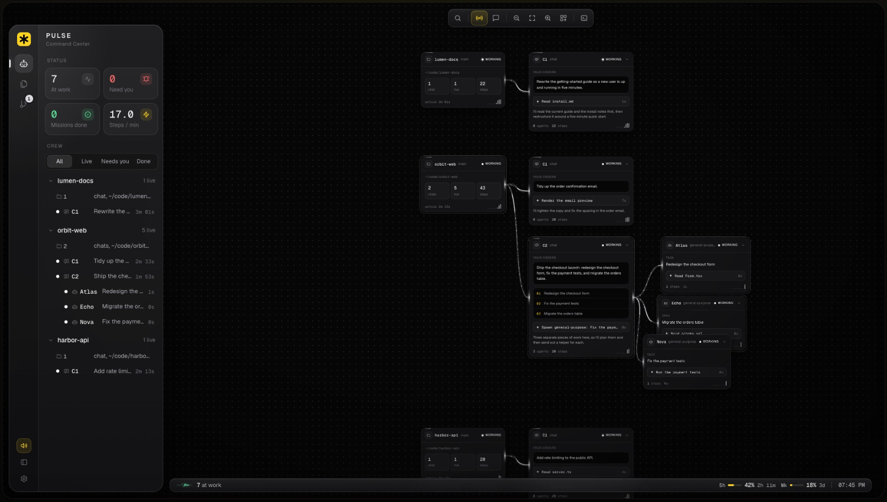

<div align="center">


# Pulse

**Mission control for Claude Code.**
One calm, live view of every Claude Code agent and subagent on your machine, with a voice that tells you what happened so you don't have to keep watching.

[](LICENSE)


[](https://github.com/pulsebridge/pulse/releases/latest)

Created by **Byrva**



</div>

## Install

Pulse comes in two parts: the **plugin**, which lets your Claude Code agents report to Pulse (always needed), and an optional **Mac app**, which gives the dashboard its own window with real terminals built in.

### Plugin + Mac app (macOS, recommended)

One command installs both:

```sh
curl -fsSL https://raw.githubusercontent.com/pulsebridge/pulse/main/install.sh | PULSE_APP=1 sh
```

Then open **Pulse** from Spotlight or your Applications folder.

### Plugin only (macOS or Linux)

```sh
curl -fsSL https://raw.githubusercontent.com/pulsebridge/pulse/main/install.sh | sh
```

Then open **http://127.0.0.1:4777** in your browser.

Either way, restart any Claude Code sessions that were already open, so they report to Pulse too. The installer checks that you have Claude Code, Node 18+ and curl, installs Pulse as a Claude Code plugin from this repository, and starts the dashboard. Run it again at any time to update.

<details>
<summary>Prefer to download the Mac app yourself?</summary>

1. Download the DMG for your Mac from the [latest release](https://github.com/pulsebridge/pulse/releases/latest): `Pulse-…-arm64.dmg` for Apple Silicon (M1 and later), `Pulse-…-x64.dmg` for Intel.
2. Open it and drag **Pulse** into **Applications**.
3. The app is not notarized by Apple yet, so the first time macOS will refuse to open it. Open **System Settings → Privacy & Security**, scroll down, and click **Open Anyway** next to the Pulse message. (Or run `xattr -dr com.apple.quarantine /Applications/Pulse.app` once.) After that it opens normally.
4. Install the plugin as well (the command above without `PULSE_APP=1`, or the two `/plugin` commands below), so your agents report to Pulse.
</details>

<details>
<summary>Prefer to install from inside Claude Code?</summary>

```
/plugin marketplace add pulsebridge/pulse
/plugin install pulse@pulse
```

Start a new Claude Code session and Pulse starts with it.
</details>

**Requirements:** macOS or Linux, [Claude Code](https://docs.claude.com/en/docs/claude-code/setup), Node.js 18+, curl. Python 3.10+ only for the optional natural voice.

## What you get

| | |
|---|---|
| **One live map** | Every project folder is a root. Each chat in that folder hangs under it, and the helper agents a chat sends out hang under the chat. Four terminals and three VS Code windows still make one Pulse. A line lights up while the agent at the end of it is working. |
| **What each agent is doing, right now** | Your orders, the step it is on with a live timer, its latest note, files touched, and recent activity. Click a card for the live transcript and a details view (pace, tool mix, health, files). |
| **"Needs you" alerts** | The moment an agent asks for permission or input, a red bar says who it is and what it wants. One click takes you to it. |
| **A voice, not another tab to watch** | Pulse speaks up when something happens: who was sent out, how each came back, anything that needs you, and one wrap-up when the crew is done. A short tone before each line tells done, failed and needs-you apart before a word is said. Choose Quiet, Normal or Verbose. Every line is also shown on screen. |
| **Stop any agent** | Stop a chat's turn or a single subagent from its card; it halts at its next step. A chat running in a Pulse terminal gets *Interrupt*, exactly like pressing Esc. |
| **Files and changes** | Browse the project, open any file, see each agent's diff, then commit and push without leaving Pulse. |
| **Plan limits** | Your 5-hour and weekly usage in the status bar, with time to reset. Amber from 75%, red from 90%. |
| **Real terminals** (Mac app) | Run Claude Code in terminals inside Pulse, with tabs and split views. Each chat links back to its card on the map. |

Everything runs on your machine. The server listens only on `127.0.0.1`, and the dashboard needs no account. The only model calls are the optional Claude Haiku ones described under Voice, made through your own `claude` login.

## How it works

<div align="center">

</div>

1. **Hooks.** The plugin registers one small shell script for every Claude Code event. It posts the event to the local Pulse server and prints the server's reply, which is empty unless you asked Pulse to stop that agent. If Pulse is not running, the event is dropped quietly and Claude carries on. The first event of a session starts the server if needed.
2. **Server.** Plain Node with no npm dependencies. It keeps the live state of every session and agent in memory, decides what is worth saying, and streams state to every open dashboard.
3. **Dashboard.** One web page. It draws the map, the sidebar and the panels, plays the voice, and sends your stop requests back to the server.
4. **Voice.** By default the page uses your browser's built-in voice. With the optional setup, lines are rendered locally by [Kokoro-82M](https://github.com/thewh1teagle/kokoro-onnx), an open-source text-to-speech model. Spoken lines come from Pulse's own phrase bank. Only Verbose briefings, and the commit messages Pulse can suggest, ask Claude Haiku for a short text through your own `claude` login, about 500 tokens each. You can turn that off in Settings.

**Stopping, exactly:** *Stop* ends a chat's current turn, or refuses every tool call a subagent attempts until it stops; the chat that sent the subagent carries on. It cannot interrupt a single long command that is already running.

## Optional extras

### Natural voice

One time, about 350 MB, needs `python3` 3.10+:

```sh
curl -fsSL https://raw.githubusercontent.com/pulsebridge/pulse/main/install.sh | PULSE_VOICE=1 sh
```

Or ask Claude: *"set up Pulse voice"*. Two voices are available in Settings, Heart (the default) and Michael. Without this step, Pulse uses your browser's voice.

### Plan limits in the status bar

Claude Code only tells its status line how much of your plan you have used, so Pulse needs to be your status line. After Pulse has run once, add this to `~/.claude/settings.json`:

```json
"statusLine": { "type": "command", "command": "sh \"$(cat ~/.pulse/plugin-root)/scripts/pulse-statusline.sh\"" }
```

It prints a line like `Opus 5.5 · 5h 42% · week 18%` under your prompt and sends the numbers to the dashboard. To keep another status line too, pass its command as the first argument; its output is shown after Pulse's. Needs a Pro or Max plan.

### Build the Mac app yourself

Downloads are on the [releases page](https://github.com/pulsebridge/pulse/releases/latest). To build from source instead (no Xcode needed):

```sh
git clone https://github.com/pulsebridge/pulse && cd pulse/app
npm install && npm run dist:dmg     # app/dist/Pulse-<version>-arm64.dmg and -x64.dmg
```

See [`app/README.md`](app/README.md) for how the app works.

## Using Pulse

- **Open it:** http://127.0.0.1:4777, or ask Claude to run `/pulse`. In VS Code, run *Simple Browser: Show* with that address to keep it beside your code.
- **Turn the voice on** with the speaker button at the bottom of the sidebar. It plays only in the tab where you switched it on.
- **Keys:** `⌘K` search · `R` spoken update now · `L` repeat the last line · `J` / `K` next / previous agent · `-` `0` `+` zoom · `A` arrange projects · `C` crew · `E` files · `G` changes · `[` collapse the sidebar · `T` terminal (Mac app) · `,` settings · `Esc` close.
- **Settings** (gear icon): how much Pulse says, sound cues, the voice, the greeting, and whether Verbose briefings and commit messages use Claude Haiku. Saved to `~/.pulse/settings.json`.

## Configuration

| Setting | Default | What it does |
|---|---|---|
| `PULSE_PORT` | `4777` | Port for the server, hooks and status line. Set it in your shell profile if 4777 is taken. |
| `PULSE_HOME` | `~/.pulse` | Where settings, the log, the voice model and its Python environment live. |

Files in `~/.pulse`: `settings.json` (your choices), `pulse.log` (server log), `plugin-root` (where the plugin is installed, written on each session start), `models/` and `venv/` (the optional voice).

## Troubleshooting

| Symptom | Fix |
|---|---|
| The page does not load | Start any Claude Code session, or ask Claude to run `/pulse`. Check `~/.pulse/pulse.log`. |
| An open chat is missing from the map | Sessions that started before Pulse was installed don't have its hooks. Restart them. |
| Nothing ever shows up | The hook needs `node` and `curl`. If Claude Code is launched from a GUI with a minimal `PATH`, Pulse also looks in Homebrew, nvm and Volta locations; the log says if Node was not found. |
| Port 4777 is busy | Set `PULSE_PORT` to another port in your shell profile and restart your sessions. |
| No sound | Click the speaker button in the sidebar (browsers block audio until you interact). For the natural voice, run the voice setup above, then restart Pulse. |
| No plan limits | Pulse must be your status line (see above), and limits are only reported on Pro and Max plans. |
| Restart Pulse | `curl -s -X POST -H 'content-type: application/json' -d '{}' http://127.0.0.1:4777/shutdown`. It starts again with your next Claude Code session, or ask Claude to run `/pulse`. |

## Uninstall

Quit Pulse.app if it is open, then:

```sh
curl -s -X POST -H 'content-type: application/json' -d '{}' http://127.0.0.1:4777/shutdown   # stop the server
claude plugin uninstall pulse@pulse
claude plugin marketplace remove pulse
rm -rf ~/.pulse
rm -rf /Applications/Pulse.app ~/Library/Application\ Support/Pulse   # if you installed the Mac app
```

If you set Pulse's status line, remove the `statusLine` entry from `~/.claude/settings.json`.

## For AI agents

Facts an agent needs to install, operate or modify Pulse. Everything below is exact.

- **What it is:** a Claude Code plugin. The marketplace and the plugin are both named `pulse`, and the plugin id is `pulse@pulse`. Manifests: `.claude-plugin/plugin.json`, `.claude-plugin/marketplace.json`.
- **Install (non-interactive):** `curl -fsSL https://raw.githubusercontent.com/pulsebridge/pulse/main/install.sh | sh`, or `claude plugin marketplace add pulsebridge/pulse && claude plugin install pulse@pulse --scope user`. Add `PULSE_APP=1` before `sh` to also install the Mac app on macOS, and `PULSE_VOICE=1` for the local voice.
- **Mac app:** optional Electron wrapper in `app/`. It uses a running Pulse server, or starts the one bundled inside it. Release DMGs are built by `.github/workflows/release.yml` when a `v*` tag is pushed. Bundle id `io.github.pulsebridge.pulse`.
- **Health check:** `curl -s http://127.0.0.1:4777/health` prints `pulse` when the server is up.
- **Stop the server:** `curl -s -X POST -H 'content-type: application/json' -d '{}' http://127.0.0.1:4777/shutdown` (POST bodies must be JSON).
- **Start the server manually:** `mkdir -p ~/.pulse && nohup node "$(cat ~/.pulse/plugin-root)/server/server.js" >> ~/.pulse/pulse.log 2>&1 &`.
- **Plugin install path:** `claude plugin list --json`, field `installPath` of id `pulse@pulse`. The hook also writes it to `~/.pulse/plugin-root` on every SessionStart.
- **Do not edit** `~/.claude/settings.json` (for example, to set the status line) without asking the user first.
- **Tests:** `node server/server.js --test` runs the full self-test, with no network and no install needed.
- **Demo:** `PULSE_PORT=4778 node server/server.js --demo` starts a simulated fleet of agents on http://127.0.0.1:4778. It stops itself 5 minutes after its last page closes.
- **No build step** for the plugin. The server is plain Node with no npm dependencies. The page is a single HTML file plus small scripts. Only the optional Mac app (`app/`) uses npm.
- **Agent status lines.** Pulse asks agents (through its SessionStart hook context) to end each reply with one line `⟦pulse⟧ <outcome> | <task>`, where outcome is `done`, `failed`, `blocked` or `needs you`. It uses that line for spoken updates.

### Repository layout

```
.claude-plugin/       plugin + marketplace manifests
hooks/hooks.json      registers scripts/pulse-hook.sh for every Claude Code event
scripts/
  pulse-hook.sh       posts each event to the server; boots it on SessionStart
  pulse-statusline.sh optional status line: plan limits to the dashboard
  setup-voice.sh      optional Kokoro voice (Python venv + model in ~/.pulse)
server/
  server.js           the server: state, hooks API, voice lines, self-test (--test), demo (--demo)
  lines.js            the phrase bank for spoken lines
  speak.py            Kokoro text-to-speech worker (optional voice)
  index.html          the dashboard page
  intro.js/.css       the greeting screen
  workspace.js/.css   files, diffs, commit and push
  terminal.js/.css    terminals for the Mac app
  vendor/             xterm.js, Monaco, Geist fonts (third-party, see vendor/README.md)
assets/               logo files
docs/                 README images
skills/pulse/         the /pulse skill: open, start, stop, voice setup, demo
app/                  optional Electron Mac app (Pulse.app)
.github/workflows/    release.yml: builds the Mac app DMGs for each version tag
install.sh            the one-command installer
```

## Contributing

Issues and pull requests are welcome. Before opening a pull request, run `node server/server.js --test`. To try a change, run the demo (`PULSE_PORT=4778 node server/server.js --demo`), or restart your local Pulse; open pages reload on their own.

**Releasing:** bump `version` in `.claude-plugin/plugin.json` and `app/package.json`, then push a tag (`git tag v0.1.0 && git push origin v0.1.0`). GitHub Actions builds both Mac DMGs and attaches them to the release.

## License

[Apache 2.0](LICENSE). Created by Byrva; see [NOTICE](NOTICE). Third-party components in `server/vendor/` keep their own licenses.
